# TẬP HỢP USER STORIES VÀ LUỒNG TRẢI NGHIỆM NGƯỜI DÙNG (IRONFITNESS / HOMEFIT)

Tài liệu này tổng hợp danh sách các **User Stories (Chuyện của người dùng)** cho ứng dụng luyện tập thể thao **IronFitness (HomeFit)**. Tất cả các User Stories, quy trình thực hiện và kịch bản kiểm thử (Acceptance Criteria) đều được trực quan hóa bằng **Biểu đồ Mermaid** thay vì bảng biểu truyền thống.

---

## 🗺️ Tổng quan Hệ thống User Stories (Epics Overview)

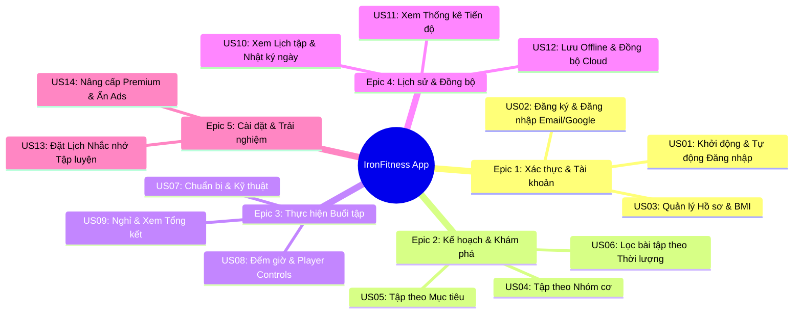

---

## 📌 Epic 1: Xác thực & Quản lý Tài khoản (Authentication & Profile)

### 🔹 US01: Khởi động & Tự động Đăng nhập (Auto Login)
**Câu chuyện người dùng:**
> *"Là một người tập luyện thường xuyên, tôi muốn ứng dụng tự động nhận diện phiên đăng nhập khi mở app để tôi có thể vào ngay màn hình tập luyện mà không phải đăng nhập lại mỗi lần."*

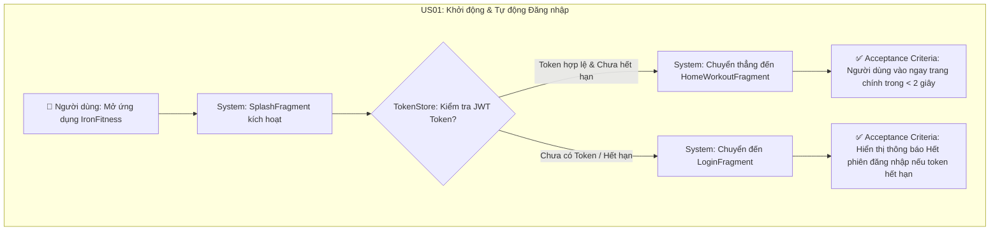

---

### 🔹 US02: Đăng ký & Đăng nhập Tài khoản (Email / Google Sign-In)
**Câu chuyện người dùng:**
> *"Là một người dùng mới, tôi muốn đăng ký/đăng nhập tài khoản bằng Email hoặc Google để lưu trữ tiến trình tập luyện cá nhân an toàn."*

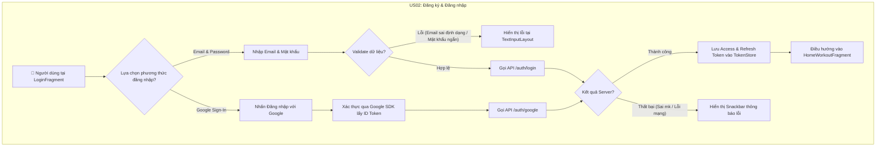

---

### 🔹 US03: Quản lý Hồ sơ Cá nhân & Theo dõi BMI
**Câu chuyện người dùng:**
> *"Là một người dùng, tôi muốn cập nhật Chiều cao và Cân nặng để ứng dụng tự động tính chỉ số BMI và phân loại thể trạng cho tôi."*

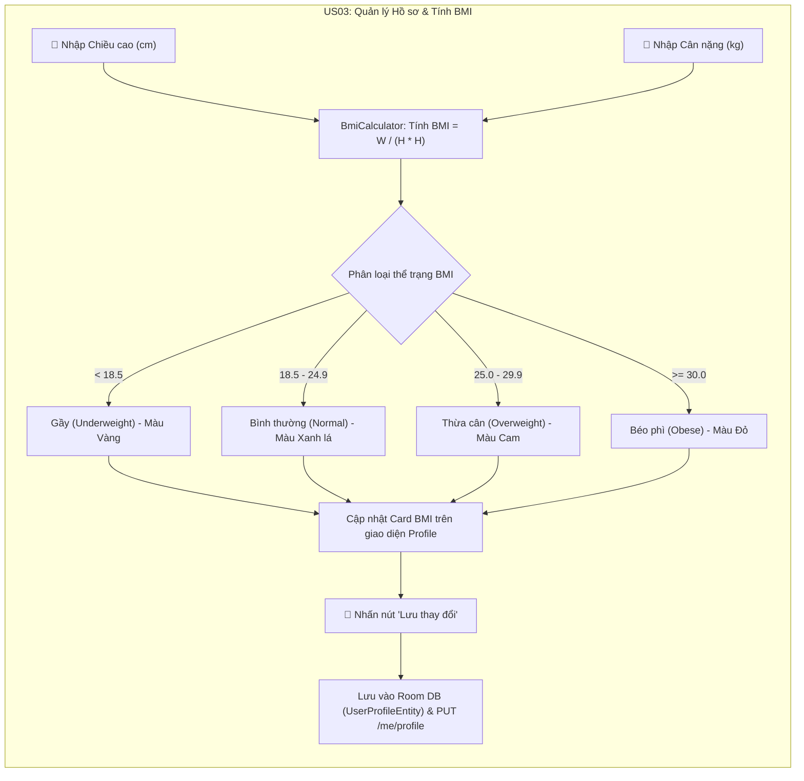

---

## 📌 Epic 2: Khám phá & Kế hoạch Tập luyện (Workout Plans)

### 🔹 US04: Chọn Bài tập theo Nhóm cơ Mục tiêu
**Câu chuyện người dùng:**
> *"Là một người tập, tôi muốn chọn nhanh bài tập theo từng nhóm cơ (Bụng, Tay, Ngực, Chân, Toàn thân) để tập trung phát triển nhóm cơ mong muốn."*

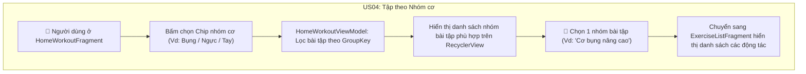

---

### 🔹 US05: Tập luyện theo Mục tiêu Phổ biến (Build Muscle / Fat Loss / Keep Fit)
**Câu chuyện người dùng:**
> *"Là một người cần định hướng tập luyện, tôi muốn ứng dụng đề xuất các lộ trình bài tập sẵn có theo mục tiêu Tăng cơ, Đốt mỡ hoặc Giữ dáng với cấp độ từ Dễ đến Khó."*

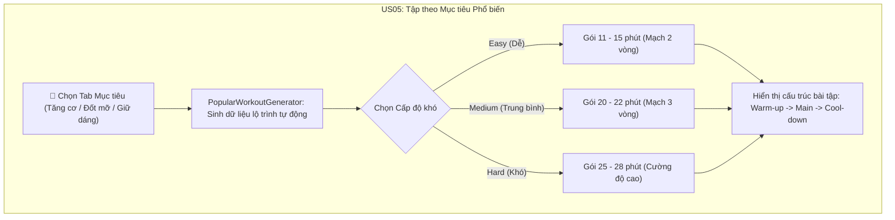

---

### 🔹 US06: Lọc Bài tập theo Thời lượng & Nhu cầu
**Câu chuyện người dùng:**
> *"Là một người bận rộn, tôi muốn lọc bài tập theo quỹ thời gian của mình (<7 phút, 7-15 phút, >15 phút) để có thể tập luyện ngay cả khi có ít thời gian rảnh."*

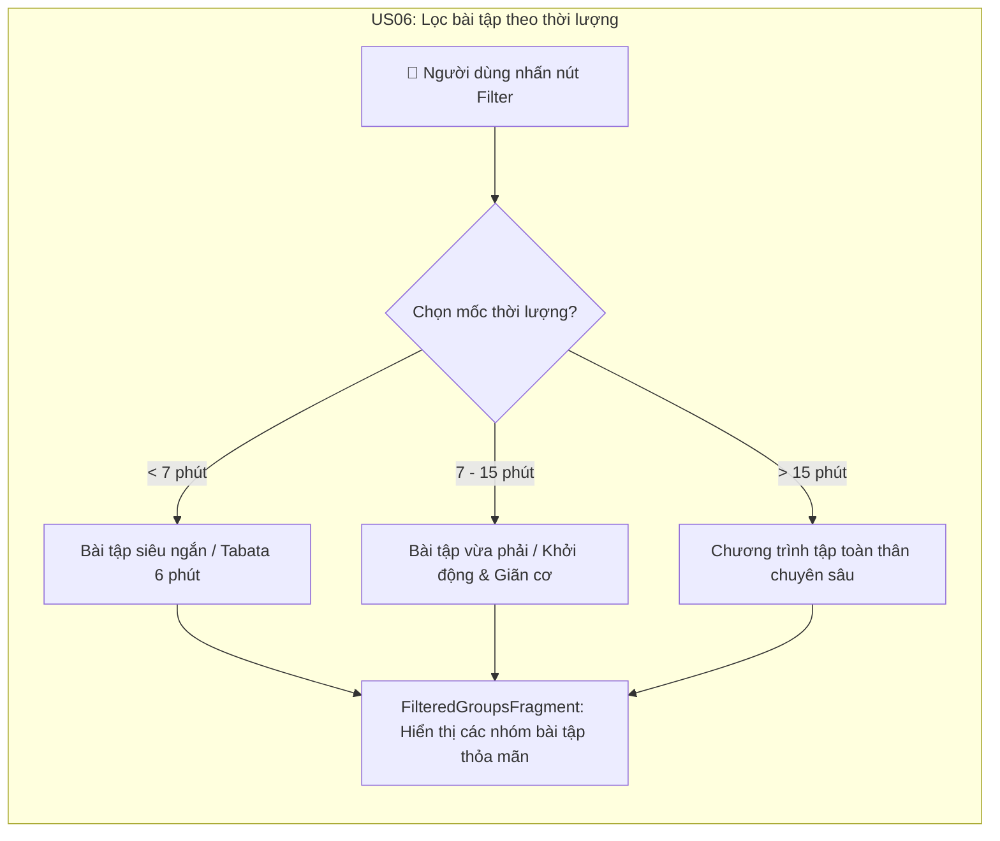

---

## 📌 Epic 3: Thực hiện & Điều khiển Buổi tập (Workout Player & Timer)

### 🔹 US07 & US08 & US09: Luồng Trình phát Bài tập Chi tiết (Player Sequence)
**Câu chuyện người dùng:**
> *"Là một người đang tập luyện, tôi muốn ứng dụng đếm ngược thời gian chuẩn bị, hiển thị hướng dẫn động tác, tự động chuyển bài và đếm thời gian nghỉ giữa các bài để tôi tập luyện liên tục mà không cần chạm vào điện thoại nhiều lần."*

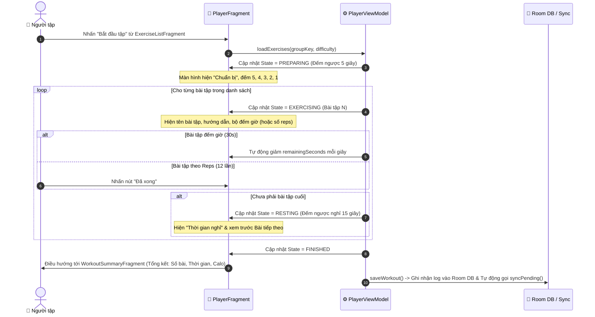

---

## 📌 Epic 4: Lịch sử & Đồng bộ Dữ liệu (History & Cloud Sync)

### 🔹 US10 & US11: Lịch tập luyện & Thống kê Tiến độ
**Câu chuyện người dùng:**
> *"Là một người theo dõi sức khỏe, tôi muốn xem lại lịch sử các ngày đã tập trong tháng qua giao diện Lịch và xem tổng số buổi tập cũng như tổng thời gian đã tích lũy."*

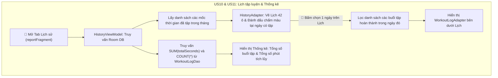

---

### 🔹 US12: Lưu trữ Offline-First & Đồng bộ Cloud (Cloud Sync)
**Câu chuyện người dùng:**
> *"Là một người dùng di động, tôi muốn ứng dụng vẫn lưu lại nhật ký tập luyện ngay cả khi không có mạng (Offline), và tự động đồng bộ lên Server khi có mạng trở lại mà không làm mất dữ liệu."*

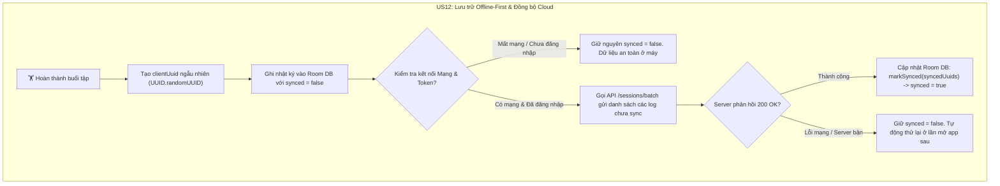

---

## 📌 Epic 5: Cài đặt Nhắc nhở & Trải nghiệm (Settings & Ads)

### 🔹 US13: Lên lịch Nhắc nhở Tập luyện Hằng ngày
**Câu chuyện người dùng:**
> *"Là một người cần tính kỷ luật, tôi muốn cài đặt giờ nhắc nhở tập luyện hằng ngày để ứng dụng gửi thông báo đúng giờ giúp tôi duy trì thói quen."*

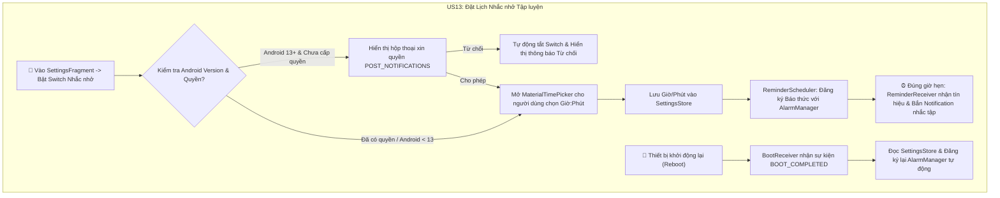

---

### 🔹 US14: Nâng cấp Premium & Trải nghiệm Không Quảng cáo
**Câu chuyện người dùng:**
> *"Là một người dùng Premium, tôi muốn ứng dụng tự động ẩn toàn bộ quảng cáo banner để có trải nghiệm tập luyện tập trung và mượt mà nhất."*

```mermaid
flowchart LR
    subgraph US14 ["US14: Kiểm tra Cờ Premium & Quản lý Quảng cáo"]
        ProfileObs["ProfileViewModel: Theo dõi UserProfileEntity từ Room DB"] --> CheckPrem{"isPremium == true?"}
        
        CheckPrem -- "Đúng (Tài khoản Premium)" --> DisableAds["AdsManager.setAdsEnabled(false)"]
        DisableAds --> HideBanner["BannerAdHelper: Ẩn adContainer & Không tải Ads"]
        
        CheckPrem -- "Sai (Tài khoản Thường)" --> EnableAds["AdsManager.setAdsEnabled(true)"]
        EnableAds --> LoadBanner["BannerAdHelper: Tải AdMob Banner Ad thử nghiệm"]
    end
end
```

---

## 🧪 Quy trình Kiểm thử & Xử lý Ngoại lệ (Edge Cases & Exception Handling)

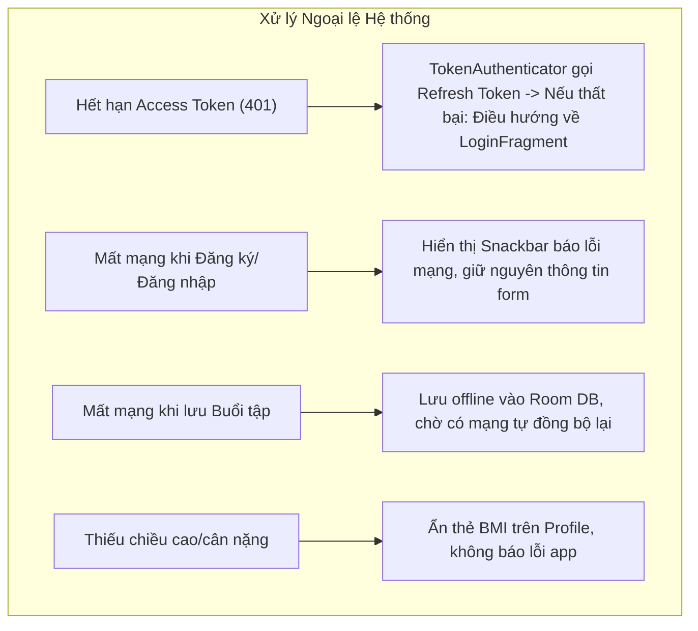
