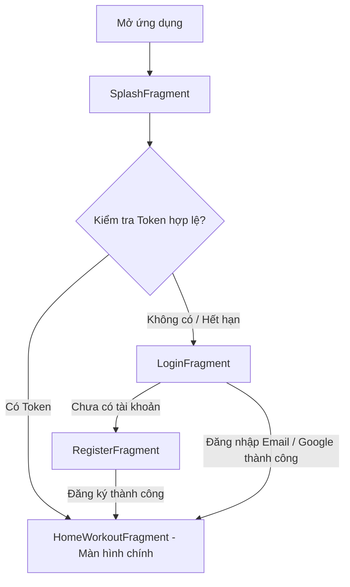
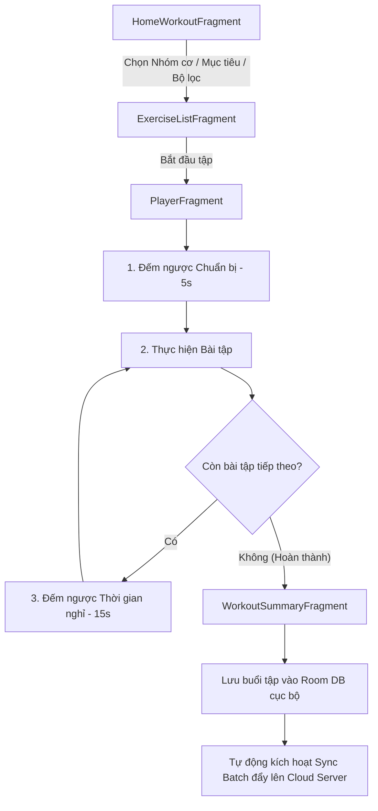
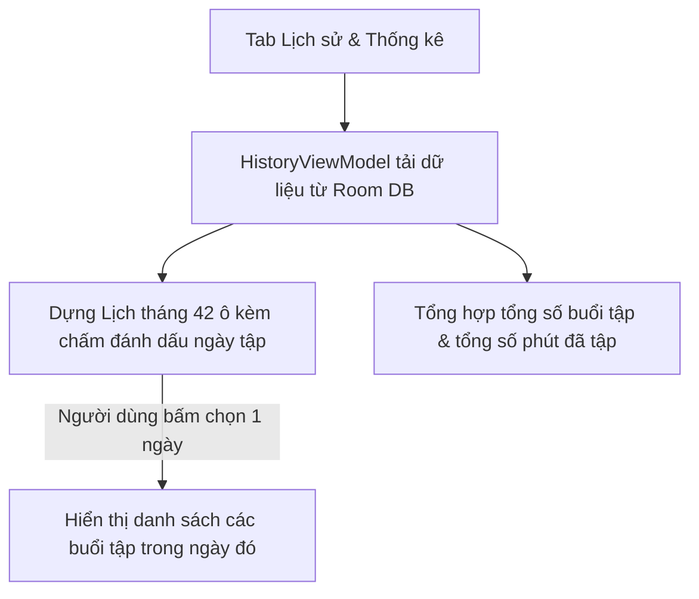
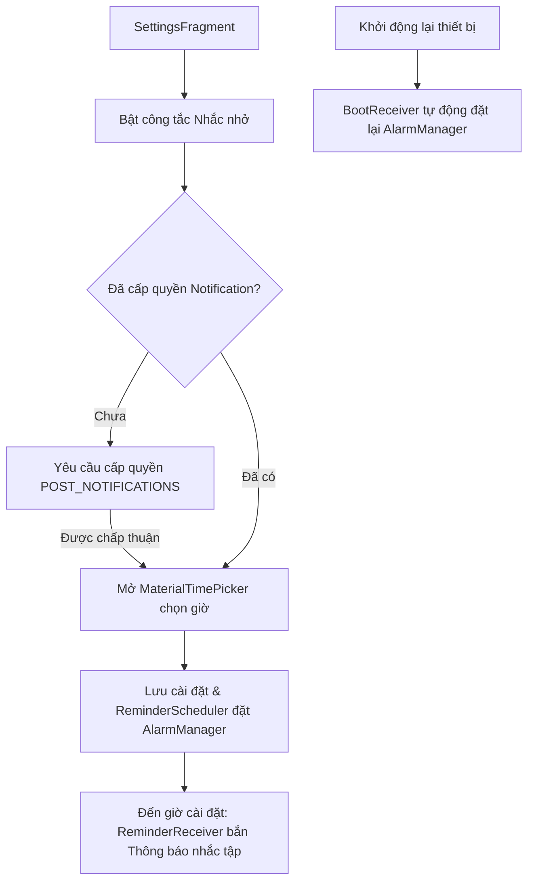

# TỔNG HỢP NỘI DUNG, CÁC TÍNH NĂNG VÀ LUỒNG HOẠT ĐỘNG ỨNG DỤNG IRONFITNESS (HOMEFIT)

## 1. Giới thiệu tổng quan (Overview)
- **Tên ứng dụng**: IronFitness (Tên thương hiệu trong app: **HomeFit** - Package: `com.homefit.app`)
- **Mục tiêu**: Ứng dụng di động hỗ trợ tập luyện thể hình và rèn luyện sức khỏe tại nhà không cần thiết bị phức tạp, giúp người dùng xây dựng thói quen tập luyện khoa học.
- **Nền tảng phát triển**: Android Native (Ngôn ngữ Java).
- **Kiến trúc phần mềm**: **MVVM (Model-View-ViewModel)** kết hợp **Repository Pattern**, kiến trúc Single-Activity (`MainActivity`) quản lý điều hướng màn hình thông qua **Android Jetpack Navigation Component** (`nav_graph.xml`).

---

## 2. Kiến trúc & Công nghệ sử dụng (Tech Stack & Architecture)

- **Giao diện & Điều hướng (UI & Navigation)**:
  - Material Design 3, View Binding.
  - Architecture Single Activity (`MainActivity`) điều hướng 4 tab chính: **Tập luyện**, **Khám phá**, **Lịch sử**, **Cài đặt**.
  - Tích hợp **Edge-to-Edge** tự động xử lý System Bars (Status bar, Navigation bar) và Bàn phím (IME Insets).
- **Lưu trữ dữ liệu cục bộ (Offline-First Persistence)**:
  - **Room Database (`AppDatabase`)**: Quản lý các cơ sở dữ liệu thực thể gồm:
    - `UserProfileEntity`: Lưu thông tin cá nhân (Tên, Email, Chiều cao, Cân nặng, Trạng thái Premium).
    - `WorkoutLogEntity`: Lưu lịch sử buổi tập (Thời gian bắt đầu/kết thúc, thời lượng, số bài hoàn thành, trạng thái đồng bộ).
    - `CategoryEntity` & `ExerciseEntity`: Danh mục nhóm cơ và thông tin chi tiết bài tập.
  - **SharedPreferences**:
    - `TokenStore`: Lưu trữ JWT Access Token, Refresh Token, User ID.
    - `SyncStore`: Lưu thời mốc đồng bộ dữ liệu.
    - `SettingsStore`: Lưu cài đặt nhắc nhở tập luyện.
  - **Assets Data (`AssetExerciseRepository`)**: Đọc và chuẩn hóa dữ liệu danh mục bài tập từ các file cấu hình JSON/Markdown trong thư mục `assets/exercises/`.
- **Mạng & API RESTful (Networking)**:
  - **Retrofit2 & OkHttp3**: Xử lý các yêu cầu gửi nhận dữ liệu với Cloud Server backend.
  - **Xác thực JWT (JSON Web Token)**:
    - `AuthInterceptor`: Tự động đính kèm Access Token vào Header của các API request.
    - `TokenAuthenticator`: Tự động gọi API Refresh Token khi nhận phản hồi lỗi `401 Unauthorized`.
- **Xử lý bất đồng bộ & Nền (Async & Background)**:
  - **AppExecutors**: Điều phối luồng xử lý riêng biệt cho Đĩa (diskIO), Mạng (networkIO), và Giao diện chính (mainThread).
  - **AlarmManager & BroadcastReceiver**: Tự động lên lịch báo thức thông báo nhắc nhở tập luyện hằng ngày (`ReminderScheduler`, `ReminderReceiver`), tự động đặt lại lịch nhắc nhở khi thiết bị khởi động lại (`BootReceiver`).
- **Quảng cáo & Tài khoản Premium (Ads & Subscription)**:
  - **Google Mobile Ads (AdMob)**: Tích hợp Banner Ads quảng cáo (`AdsManager`, `BannerAdHelper`).
  - **Cơ chế Premium**: Tự động kiểm tra trạng thái tài khoản và ẩn toàn bộ quảng cáo khi tài khoản là Premium (`isPremium = true`).

---

## 3. Danh sách Tính năng chính (Core Features)

### 3.1. Xác thực & Quản lý Tài khoản (Authentication & User Profile)
1. **Khởi động & Kiểm tra phiên đăng nhập (`SplashFragment`)**:
   - Tự động kiểm tra Token còn hiệu lực hay không để điều hướng thẳng vào Trang chủ Tập luyện hoặc chuyển về Màn hình Đăng nhập.
2. **Đăng nhập & Đăng ký (`LoginFragment`, `RegisterFragment`)**:
   - Hỗ trợ đăng nhập / đăng ký tài khoản qua Email & Mật khẩu với kiểm tra ràng buộc dữ liệu đầu vào (`AuthValidator`).
   - Tích hợp Đăng nhập nhanh bằng tài khoản Google (Google Sign-In với ID Token).
3. **Quản lý Hồ sơ Cá nhân & Chỉ số BMI (`ProfileFragment`)**:
   - Cập nhật thông tin: Tên hiển thị, Chiều cao (cm), Cân nặng (kg).
   - Tự động tính chỉ số **BMI (Body Mass Index)** tức thì khi người dùng gõ số liệu và phân loại thể trạng: **Underweight (Gầy), Normal (Bình thường), Overweight (Thừa cân), Obese (Béo phì)**.
   - Hiển thị phân hạng tài khoản (Thành viên Thường vs Thành viên Premium).

### 3.2. Kế hoạch & Chương trình Tập luyện (Home Workout Plans)
1. **Trang chủ Tập luyện (`HomeWorkoutFragment`)**:
   - Phân loại danh mục bài tập theo nhóm cơ mục tiêu: **Bụng, Tay, Ngực, Chân, Toàn thân**.
   - Các lộ trình tập luyện phổ biến tự sinh (`PopularWorkoutGenerator`):
     - **Tăng cơ (Build Muscle)**: Ngực & Tay, Chân & Mông, Thân trên + Lõi.
     - **Đốt mỡ (Fat Loss)**: Đốt mỡ nhẹ nhàng, HIIT toàn thân, Đốt cháy calo toàn thân.
     - **Giữ dáng (Keep Fit)**: Toàn thân cân bằng, Toàn thân + Lõi, Sức bền toàn thân.
     - Phân cấp theo 3 độ khó: **Easy (Dễ), Medium (Trung bình), Hard (Khó)**.
   - Thử thách "Ngày bắt đầu" (Ngày 1 - Toàn thân cơ bản).
2. **Bộ lọc & Khám phá bài tập (`FilteredGroupsFragment`, `DiscoverFragment`)**:
   - Lọc bài tập theo thời lượng: `<7 phút`, `7-15 phút`, `>15 phút`.
   - Các bài tập chuyên biệt: 6 phút Tabata, Kéo giãn Lưng, Đốt cháy calo toàn thân, Thử thách sức mạnh chân.
3. **Danh sách & Chi tiết Bài tập (`ExerciseListFragment`, `ExerciseDetailFragment`)**:
   - Hiển thị danh sách các bài tập trong từng nhóm.
   - Chi tiết hướng dẫn thực hiện từng động tác, thứ tự các bước, mẹo tập luyện đúng kỹ thuật và lưu ý an toàn.

### 3.3. Trình phát bài tập & Bộ đếm giờ (`Workout Player & Timer`)
1. **Bộ điều khiển Buổi tập (`PlayerFragment`, `PlayerViewModel`)**:
   - **Đếm ngược Chuẩn bị (PREPARING)**: 5 giây đếm ngược trước khi vào bài tập đầu tiên.
   - **Thực hiện bài tập (EXERCISING)**:
     - Bài tập theo thời lượng (ví dụ 30s, 40s): Bộ đếm thời gian tự động đếm ngược.
     - Bài tập theo số lần/hiệp (ví dụ 10-12 lần): Cho phép người dùng chủ động bấm hoàn thành.
   - **Đếm ngược Thời gian nghỉ (RESTING)**: 15 giây đếm ngược chuyển tiếp giữa 2 bài tập.
   - **Điều khiển đa dạng**: Tạm dừng/Tiếp tục (Play/Pause), Bỏ qua bài tập (Next), Quay lại bài trước (Previous).
2. **Màn hình Tổng kết Buổi tập (`WorkoutSummaryFragment`)**:
   - Thống kê chi tiết ngay sau khi hoàn thành: Tổng thời gian luyện tập, số động tác đã hoàn thành, lượng calo tiêu thụ ước tính.

### 3.4. Lịch sử & Thống kê Tập luyện (History & Tracking)
1. **Lịch theo dõi tập luyện (`HistoryFragment`, `HistoryViewModel`)**:
   - Giao diện Lịch tháng dạng lưới 42 ô (Calendar View).
   - Đánh dấu trực quan các ngày người dùng có thực hiện tập luyện bằng dấu chấm trên lịch.
   - Chọn ngày bất kỳ để xem danh sách chi tiết các buổi tập diễn ra trong ngày đó.
2. **Thống kê tổng hợp**:
   - Đếm tổng số buổi tập hoàn thành.
   - Tính tổng số thời gian đã rèn luyện (phút/giờ).
3. **Đồng bộ Dữ liệu Offline-First & Cloud Sync**:
   - Khi tập xong, dữ liệu được lưu ngay vào Room DB cục bộ kèm mã `clientUuid` ngẫu nhiên và cờ `synced = false`.
   - Tự động kích hoạt **Batch Sync** đẩy dữ liệu lên Server qua API REST (`/sessions/batch`).
   - Hỗ trợ khôi phục toàn bộ lịch sử tập luyện từ Cloud khi người dùng đăng nhập trên thiết bị mới (`restoreHistory`).

### 3.5. Cài đặt & Nhắc nhở (`Settings & Reminders`)
1. **Lên lịch Nhắc nhở hằng ngày (`SettingsFragment`)**:
   - Công tắc Bật/Tắt nhắc nhở tập luyện.
   - Lựa chọn thời gian nhắc nhở thông qua giao diện `MaterialTimePicker` chuẩn Android.
   - Xử lý xin quyền gửi thông báo trên Android 13+ (`POST_NOTIFICATIONS`).
2. **Báo thức & Tự động khôi phục**:
   - Sử dụng `AlarmManager` đăng ký báo thức chính xác thời gian người dùng đặt.
   - Tích hợp `BootReceiver` tự động đăng ký lại lịch nhắc nhở mỗi khi thiết bị khởi động lại (`BOOT_COMPLETED`).
3. **Quản lý Đăng xuất**: Đăng xuất tài khoản an toàn, xóa các thông tin Token trong `TokenStore` và thông tin bộ nhớ tạm.

---

## 4. Luồng hoạt động chính của Ứng dụng (Application Workflows)

### 🔄 Luồng 1: Khởi động & Xác thực Người dùng (Auth Flow)


### 🏋️‍♂️ Luồng 2: Chọn Kế hoạch & Thực hiện Tập luyện (Workout Flow)


### 📅 Luồng 3: Theo dõi Lịch sử & Thống kê (History & Tracking Flow)


### 🔔 Luồng 4: Cài đặt Nhắc nhở Tập luyện (Reminder Flow)


---

## 5. Cấu trúc Thư mục Nguồn (Project Structure)

```text
com.homefit.app
├── HomeFitApp.java               # Application class khởi tạo ứng dụng
├── MainActivity.java             # Single Activity chứa NavHostFragment & Bottom Navigation View
├── MainViewModel.java            # ViewModel quản lý trạng thái phiên đăng nhập cấp Activity
├── ads/                          # Quản lý Quảng cáo AdMob
│   └── AdsManager.java
├── data/                         # Tầng Dữ liệu (Data Layer)
│   ├── local/                    # Cơ sở dữ liệu nội địa Room DB, Prefs, Assets
│   │   ├── AppDatabase.java
│   │   ├── AssetExerciseRepository.java
│   │   ├── dao/                  # Data Access Objects (Exercise, Category, UserProfile, WorkoutLog)
│   │   ├── dto/                  # DTO dữ liệu cục bộ
│   │   └── entity/               # Thực thể Room DB (UserProfileEntity, WorkoutLogEntity,...)
│   ├── prefs/                    # Storage SharedPreferences (TokenStore, SyncStore)
│   ├── remote/                   # Retrofit API Services, Interceptors, DTOs
│   └── repository/               # Repositories (AuthRepository, ExerciseRepository, WorkoutLogRepository)
├── domain/                       # Mappers chuyển đổi định dạng dữ liệu Entity <-> DTO
├── notification/                 # Broadcast Receivers & Schedulers phục vụ thông báo nhắc nhở
├── ui/                           # Tầng Giao diện Người dùng (UI Layer)
│   ├── ads/                      # Activity Demo AdMob
│   ├── auth/                     # Splash, Login, Register Fragments & ViewModels
│   ├── common/                   # Common UI Helpers (BannerAdHelper, SnackbarHelper, Event...)
│   ├── discover/                 # Discover Fragment (Khám phá bài tập)
│   ├── history/                  # History Fragment, Calendar Adapters, ViewModels
│   ├── library/                  # Category, Exercise List, Exercise Detail
│   ├── player/                   # Player Fragment, Workout Summary & Timer ViewModel
│   ├── profile/                  # Profile Fragment & BMI Calculator
│   ├── settings/                 # Settings Fragment & ViewModel (Cài đặt & Nhắc nhở)
│   └── workout/                  # Home Workout, Filtered Groups & Generator
└── util/                         # Utilities (AppExecutors, BmiCalculator, DateUtils, Resource...)
```
